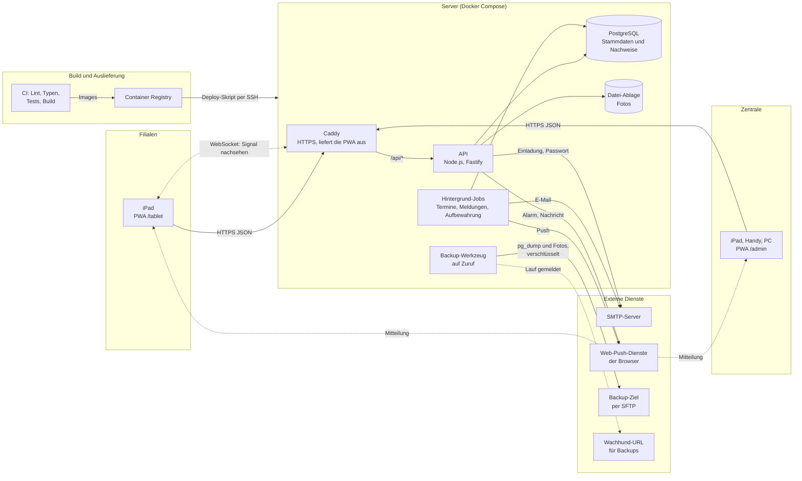
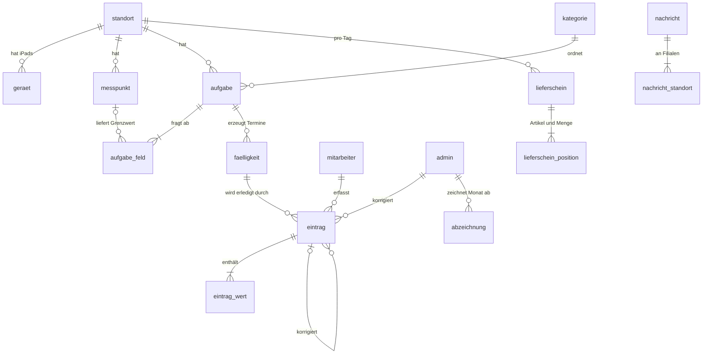

# Filial-App für eine Bäckereikette

> **Hinweis:** Anonymisierter Ausschnitt eines produktiven Kundenprojekts. Vollständiger Code und Kundendaten sind nicht öffentlich.

Dieses Repository zeigt Aufbau, Arbeitsweise und einige Codeausschnitte einer Web-App für die Filialen einer
Bäckereikette. Es ist keine lauffähige Kopie der App. Alle Namen, Daten und Beispiele sind erfunden.

## Ausgangslage

Eine Bäckereikette mit neun Filialen und einer Backstube arbeitet mit einer ca. 25 Jahre alten Warenwirtschaft ohne
Schnittstelle. Kontrollen nach HACCP (zum Beispiel Kühltemperaturen, Reinigung, Wareneingang) liefen auf
Papierlisten, Informationen an die Filialen auf Infozetteln, Retouren wurden abends von Hand auf den Lieferschein
geschrieben.

Der Inhaber hatte eine klare Priorität: zuerst digitale HACCP-Checklisten und Nachrichten mit Alarm an die Filialen.
Weil die Warenwirtschaft keine Schnittstelle hat, kommen Liefermengen für die Retouren vorerst nicht automatisch: Die
Zentrale trägt sie von Hand ein oder kopiert sie aus einer Tabelle.

## Lösung

Eine Web-App (PWA) mit zwei Bereichen auf demselben Server. Jedes Filial-iPad sieht nur seinen eigenen Standort.

### Am iPad in der Filiale

- **Koppeln statt Konto:** Ein iPad wird einmalig mit einem kurzlebigen Code an einen Standort gebunden. Danach
  meldet sich jede Person für eine Handlung mit Personalnummer und eigener vierstelliger PIN an.
- **Aufgaben des Tages:** Die App zeigt, was in welchem Zeitfenster fällig ist, und was offen, versäumt oder erledigt
  ist. Fragetypen: Temperatur, Haken, in Ordnung oder nicht, Zahl, Text, Auswahl, Foto (zum Beispiel ein Foto der
  Theke) und Retouren.
- **Abweichungen:** Liegt eine Temperatur außerhalb des Grenzwerts, sind eine Maßnahme und die Frage „Was ist mit der
  Ware?“ Pflicht. Danach muss innerhalb von 30 Minuten nachgemessen werden, sonst bleibt eine sichtbare Lücke.
- **Retouren zählen:** Zum Ladenschluss geht die Filiale den Lieferschein des Tages Artikel für Artikel durch.
- **Nachrichten und Alarm:** Die Zentrale schickt normale Nachrichten oder einen Alarm, der den ganzen Bildschirm
  füllt und bestätigt werden muss. Neue Nachrichten kommen über eine Live-Verbindung (WebSocket), bei geschlossener
  App per Web Push.
- **Nachweise:** Die Filiale sieht ihre eigenen Nachweise der letzten 92 Tage.

### In der Zentrale

- **Heute:** Probleme zuerst, also versäumte Aufgaben, Abweichungen, offene Nachmessungen und iPads ohne Verbindung.
- **Nachweise:** pro Tag und Filiale, mit allen Fassungen. Eine Korrektur ist ein neuer Eintrag mit Begründung, das
  Original bleibt erhalten. Monate werden abgezeichnet. Export als PDF und CSV für die Lebensmittelkontrolle.
- **Pflege:** Checklisten mit Zeitplänen und Fragen, Kategorien, Messpunkte mit Grenzwerten (Änderung nur mit Grund
  und Verlauf), Maßnahmen-Vorlagen, Mitarbeitende (auch per Import), Standorte mit Öffnungs- und Schließtagen, iPads
  koppeln und sperren.
- **Retouren:** Auswertung pro Tag mit Rückgabequote, Liste „Viel zurück“ und Filialen, die noch nicht gezählt haben.
- **Konten:** Anmeldung mit Passwort und optional einem zweiten Faktor per Authenticator-App, neue Admins nur per
  Einladung, Passwort zurücksetzen per E-Mail, Protokoll aller Änderungen.
- **Benachrichtigungen:** wichtige Ereignisse per Push oder E-Mail.

### Was von selbst läuft

Der Server legt alle 5 Minuten die Termine aller aktiven Filialen an, prüft alle 30 Sekunden auf neue Ereignisse und
verschickt Benachrichtigungen, und räumt stündlich Fotos und Nachweise nach Ablauf ihrer Aufbewahrungsfrist auf.

## Architektur

**Schichten im Code** (Monorepo mit pnpm-Workspaces):

| Bereich              | Aufgabe                                                                                   |
| -------------------- | ----------------------------------------------------------------------------------------- |
| `apps/web`           | React-PWA mit den Bereichen `/tablet` und `/admin`                                        |
| `apps/api`           | Routen (prüfen, wer fragt), Dienste (Abläufe), Datenzugriff, Migrationen                  |
| `packages/fachlogik` | Reine Fachregeln ohne Datenbank und Oberfläche: Grenzwerte, Termine, Status, Nachmessung  |
| `packages/shared`    | zod-Schemas als Vertrag zwischen Oberfläche und Server                                    |
| `infra`              | Dockerfile, Docker Compose, Caddy, Deploy- und Backup-Skripte                             |

Die Fachlogik hängt von nichts ab, auch die Uhrzeit wird ihr hineingereicht. So lässt sie sich ohne Datenbank und
ohne echte Uhr testen. Das iPad zeigt eine Abweichung schon beim Tippen an, maßgeblich ist aber die Prüfung auf dem
Server, und die Zeit im Nachweis ist immer die Server-Zeit.

**Datenfluss beim Speichern einer Messung:** iPad sendet Eintrag mit Geräte-Token und Handlungs-Token, die Route
prüft die Eingabe (zod) sowie Gerät und Person, der Dienst lädt Termin und gültige Grenzwerte, die Fachlogik bewertet
den Wert, der Dienst hängt Eintrag, Antworten und Protokoll in einer Transaktion an. Siehe
[`examples/01-api-endpoint-eintrag.ts`](examples/01-api-endpoint-eintrag.ts).

## Tech-Stack

Nur, was im Code des Originals steckt:

| Bereich        | Technik                                                                                                   |
| -------------- | --------------------------------------------------------------------------------------------------------- |
| Sprache        | TypeScript 6 (strict, `noUncheckedIndexedAccess`), Node.js 24 LTS, pnpm-Workspaces                        |
| Frontend       | React 18, Vite 8, Tailwind CSS 4, TanStack Query 5, React Router 7, vite-plugin-pwa mit Workbox           |
| Backend        | Fastify 5 mit `@fastify/websocket`, `@fastify/rate-limit`, `@fastify/cookie`                              |
| Daten          | PostgreSQL 16, Drizzle ORM und drizzle-kit (Migrationen), node-postgres, eigene SQL-Trigger               |
| Validierung    | zod 4, geteilt zwischen Oberfläche und Server                                                             |
| Sicherheit     | argon2id für Passwörter und PINs, TOTP nach RFC 6238, AES-256-GCM für gespeicherte TOTP-Geheimnisse       |
| Dienste        | nodemailer (E-Mail), web-push mit VAPID (Push), pdfkit (PDF-Export), qrcode (Einrichtung 2FA)            |
| Tests          | Vitest 5 mit Abdeckungs-Untergrenzen, Playwright (Chromium und WebKit)                                    |
| Code-Qualität  | ESLint, Prettier, TypeScript-Prüfung in der CI                                                            |
| Infrastruktur  | Docker, Docker Compose, Caddy 2, GitHub Actions, Container Registry, Dependabot, age für Backups          |

## Datenmodell

Vereinfachte Übersicht. Das Original hat 33 Tabellen und 38 Migrationen. Die Tabellen zerfallen in drei Bereiche:
**Zugang** (wer darf rein), **Vorlagen** (was ist zu tun) und **Nachweise** (was wurde getan, ändert sich nie).

| Bereich   | Tabellen (Auswahl)                                                         | Inhalt                                                                  |
| --------- | -------------------------------------------------------------------------- | ----------------------------------------------------------------------- |
| Zugang    | `standort`, `geraet`, `kopplungscode`, `mitarbeiter`, `admin`, Sitzungen   | Nur Hashes von Tokens, PINs und Passwörtern, nie die Werte selbst      |
| Vorlagen  | `kategorie`, `aufgabe`, `aufgabe_feld`, `messpunkt`, `massnahme_vorlage`   | Was wann wo zu tun ist, mit Grenzwerten                                 |
| Termine   | `faelligkeit`                                                              | Ein Zeitfenster pro Aufgabe und Tag, vom Hintergrund-Job angelegt       |
| Nachweise | `eintrag`, `eintrag_wert`, `abzeichnung`, `audit_log`                      | Nur anhängbar, Korrektur als neuer Eintrag mit Verweis auf das Original |
| Retouren  | `lieferschein`, `lieferschein_position`                                    | Liefermengen pro Filiale und Tag, die Zählung steht im Eintrag          |
| Nachrichten | `nachricht`, `nachricht_standort`, Push-Abos                             | Nachricht, Alarm, gelesen und bestätigt pro Filiale                     |

Grundregeln aus dem Projekt:

1. **Nachweise ändern sich nie.** Trigger in der Datenbank lehnen `UPDATE`, `DELETE` und `TRUNCATE` ab
   ([`examples/02-migration-nachweise-unveraenderbar.sql`](examples/02-migration-nachweise-unveraenderbar.sql)).
2. **Ein Nachweis bleibt für sich lesbar.** Frage, Einheit, Grenzwert und Maßnahmentext werden beim Erfassen in den
   Nachweis kopiert. Spätere Änderungen an den Vorlagen verändern alte Nachweise nicht.
3. **Was sich ausrechnen lässt, wird nicht gespeichert.** Der Status eines Termins (offen, versäumt, erledigt) wird
   aus Zeitfenster, Einträgen und Uhrzeit gerechnet.
4. **Die Datenbank prüft, ob etwas zusammenpasst, die Fachlogik, ob es fachlich richtig ist.**

## Betrieb

Soweit im Code des Originals erkennbar:

**Deployment**

- Drei Container per Docker Compose: Caddy (HTTPS mit automatischem Zertifikat, liefert die gebaute PWA aus), API und
  PostgreSQL. Backup und Wiederherstellen laufen als Werkzeug-Container nur auf Zuruf.
- Die CI läuft bei jedem Push und Pull Request: Lint, Typprüfung, Tests mit Abdeckungs-Untergrenzen gegen eine echte
  PostgreSQL, Build, Browser-Tests der Kernabläufe in Chromium und WebKit.
- Auf dem Hauptbranch baut die CI die Images (API, Caddy mit PWA, Backup), versieht sie mit dem kurzen Commit-Hash und
  legt sie in einer Container Registry ab. Ein Deploy-Skript überträgt per SSH die Compose-Datei, setzt die Version und
  startet die neuen Images.
- Datenbank-Migrationen laufen beim Start der API automatisch.
- Fremde GitHub Actions und Basis-Images sind auf feste Kennungen (SHA bzw. Digest) gepinnt, Updates schlägt
  Dependabot als Pull Request vor.
- Caddy setzt Sicherheits-Header (HSTS, `nosniff`, Referrer- und Permissions-Policy) und sorgt dafür, dass neue
  Fassungen der PWA ankommen: Dateien ohne Hash im Namen werden nie aus dem Cache bedient.

**Monitoring**

- `GET /api/health` liefert Status, Version und Server-Zeit und prüft die Datenbank. Ist sie nicht erreichbar, kommt
  `503`. Das API-Image hat einen Docker-`HEALTHCHECK`.
- Strukturierte JSON-Logs (Fastify und Caddy). Query-Strings werden aus den Request-Logs entfernt, damit keine
  personenbezogenen Daten oder Tokens darin landen.
- Das Backup meldet jeden Lauf an eine Wachhund-URL. Bleibt die Meldung aus, schlägt der externe Dienst Alarm.
- Ein externer Uptime-Check auf `/api/health` ist vorgesehen, laut Doku aber noch nicht eingerichtet.

**Fehlerbehandlung**

- Die Konfiguration wird beim Start mit zod geprüft. In Produktion bricht der Start ab, wenn Pflichtwerte fehlen
  ([`examples/03-konfiguration-und-jobs.ts`](examples/03-konfiguration-und-jobs.ts)).
- Hintergrund-Jobs überholen sich nie, ein Fehler wird geloggt und der nächste Lauf versucht es erneut. Teilschritte
  sind getrennt, damit ein Fehler beim Prüfen nicht den Versand blockiert. Der Server startet auch, wenn der erste
  Terminlauf scheitert. Bei `SIGTERM` warten die Jobs ihren laufenden Durchgang ab.
- Die API antwortet mit klaren Statuscodes: ungültige Eingabe `400`, fremder oder unbekannter Termin `404`, Konflikt
  (schon erledigt, Monat abgezeichnet) `409`, fachlich unvollständig `422`. Anmeldung, Kopplung, Foto-Upload und Push
  sind gegen Durchprobieren und Überlastung begrenzt.
- Doppelt gesendete Einträge zählen nur einmal: Die Eintrags-ID erzeugt das iPad, der Server erkennt Wiederholungen.
- In der Oberfläche fängt eine Fehlergrenze Abstürze ab und bietet Neuladen an. Eingaben einer offenen Aufgabe
  überstehen einen Verbindungsabbruch.
- Backups: Datenbank-Dump und Fotos, mit age verschlüsselt, per SFTP auf ein externes Ziel, mit Aufbewahrungsregel und
  Skript zum Zurückspielen. Im Probelauf zurückgespielt, auf einem echten Server laut Doku noch nicht eingerichtet.

## Arbeitsweise

Entwickelt mit zwei Coding-Agents: Claude Code schreibt den Code, Codex macht unabhängige Code-Reviews. Struktur,
Prüfung des erzeugten Codes und Tests liegen bei mir.

Im Repository sichtbar:

- **Entscheidungen schriftlich:** 17 Architecture Decision Records (ADRs), zum Beispiel zu Schichten, Datenmodell,
  Trennlinie Datenbank und Fachlogik, Hintergrund-Jobs, Backup und PWA-Updates.
- **Ein Branch pro Funktion**, Zusammenführen nur über Pull Request mit grüner CI.
- **Reviews mit Protokoll:** Review-Aufträge und Funde stehen in der Doku, jeder Fund wird entschieden (beheben,
  bewusst lassen, als falsch begründen).
- **Tests auf mehreren Ebenen:** 76 Testdateien für Fachlogik, Datenbankregeln, Dienste und Routen, dazu 4
  Playwright-Spezifikationen für die Kernabläufe im Browser. Die CI bricht unter festen Abdeckungs-Untergrenzen ab.
- **Grenzen offen benannt:** Eine eigene Datei listet, was bewusst noch fehlt und was vor dem Echtbetrieb nötig ist.

Zahlen: Stand des Originals vom 07.11.2026.

## Learnings

**Datenzugang und externe Beteiligte vor dem Bauen klären.** Funktionen, die Daten aus einer Warenwirtschaft ohne
Schnittstelle brauchen, lassen sich nicht einfach planen. Bevor ein Umfang zugesagt wird, gehören diese Fragen
geklärt:

- Welche Daten werden gebraucht, und wo liegen sie heute?
- Gibt es einen Export, eine Schnittstelle oder einen Ansprechpartner beim Hersteller?
- Wer muss außer dem Auftraggeber zustimmen oder mitarbeiten (Softwarehersteller, IT-Dienstleister, Mitarbeitende)?
- Was passiert, wenn der Datenweg nicht kommt? Gibt es eine Übergangslösung, zum Beispiel manuelle Eingabe oder
  Tabellen-Import?

In diesem Projekt hat genau diese Übergangslösung getragen: Die Retouren werden digital gezählt, die Liefermengen
kommen vorerst per Hand oder aus einer Tabelle.

## Inhalt dieses Repositorys

| Pfad                                                                                       | Inhalt                                               |
| ------------------------------------------------------------------------------------------ | ---------------------------------------------------- |
| [`examples/01-api-endpoint-eintrag.ts`](examples/01-api-endpoint-eintrag.ts)               | API-Endpoint mit Validierung und Fehlercodes         |
| [`examples/02-migration-nachweise-unveraenderbar.sql`](examples/02-migration-nachweise-unveraenderbar.sql) | Migration: Trigger und Check-Constraints |
| [`examples/03-konfiguration-und-jobs.ts`](examples/03-konfiguration-und-jobs.ts)           | Konfiguration prüfen, Hintergrund-Jobs absichern     |
| [`examples/04-fachlogik.ts`](examples/04-fachlogik.ts)                                     | Reine Fachregeln: Grenzwert, Status, Retouren        |
| [`examples/05-fachlogik.test.ts`](examples/05-fachlogik.test.ts)                           | Tests zur Fachlogik mit erfundenen Beispieldaten     |
| [`docs/screenshots/`](docs/screenshots/)                                                   | Anleitung für Screenshots                            |
| [`.env.example`](.env.example)                                                             | Konfiguration, nur Platzhalter                       |

Die Ausschnitte sind gekürzt und verallgemeinert. Importe auf Teile, die hier fehlen, sind als Kommentar markiert.
